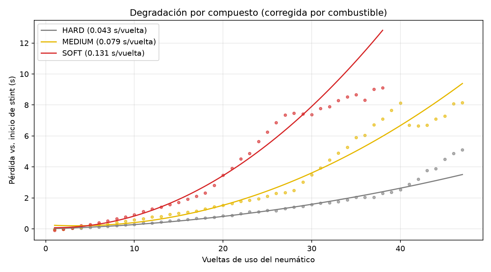
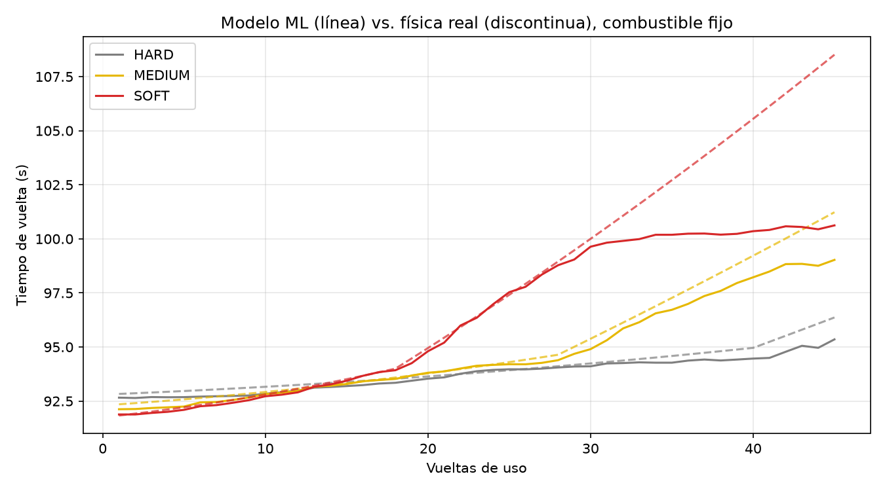
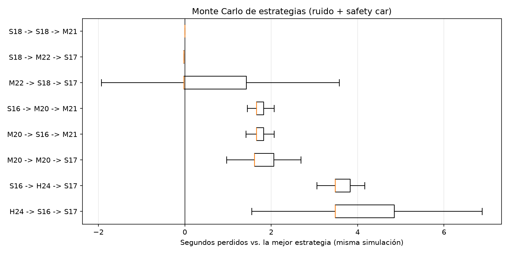

# 🏎️ TyreSim: degradación de neumáticos y simulación de estrategias de carrera

Proyecto en Python que **analiza la degradación de neumáticos** a partir de datos vuelta a vuelta,
**entrena modelos de Machine Learning** para predecir el tiempo por vuelta y **simula miles de estrategias de carrera** (1 y 2 paradas) con Monte Carlo para encontrar la más rápida.

**Stack:** Python 3.10+, Pandas, NumPy, Scikit-Learn, Matplotlib y Pytest.

## ¿Qué hace?

| Módulo | Qué hace | Técnicas |
|---|---|---|
| `physics.py` | Modelo "real" del tiempo por vuelta: combustible, desgaste lineal + cuadrático, *cliff* y temperatura de pista | NumPy vectorizado |
| `data_gen.py` | Genera ~23 000 vueltas sintéticas (20 carreras × 20 pilotos) con ruido, tráfico y paradas | `np.random.Generator`, DataFrames |
| `analysis.py` | Limpieza (regla del 107 %), corrección por combustible, curvas de degradación, detección del *cliff*, efecto de la temperatura | `groupby`, `transform`, `join`, `pivot_table`, `pd.cut`, `rolling`, `np.polyfit` |
| `model.py` | Regresión polinómica (Ridge) y Gradient Boosting dentro de un `Pipeline` | `ColumnTransformer`, `OneHotEncoder`, `GroupKFold` |
| `simulator.py` | Enumera unas 3 800 estrategias legales, las ordena y corre Monte Carlo con safety cars | Matrices `(n_sims, vueltas)`, *common random numbers* |

## Uso

```bash
python -m venv .venv && source .venv/bin/activate
pip install -r requirements.txt

python -m tyresim generate                 # crea data/laps.csv
python -m tyresim analyze                  # análisis de degradación + outputs/degradation.png
python -m tyresim train                    # validación cruzada + outputs/model_vs_truth.png
python -m tyresim simulate --temp 35       # estrategias con el modelo físico
python -m tyresim simulate --use-ml --temp 45   # estrategias usando el modelo de ML
pytest                                     # tests
```

## Resultados

**Degradación estimada** (s/vuelta en las primeras 15 vueltas, corregida por combustible):

| Compuesto | s/vuelta | R² del ajuste |
|---|---|---|
| SOFT | 0.131 | 0.91 |
| MEDIUM | 0.079 | 0.89 |
| HARD | 0.043 | 0.79 |

Con la pista sobre 40 °C, la degradación del blando pasa de 0.13 a 0.22 s/vuelta.



**Modelos** (validación cruzada de 5 folds agrupada por carrera):

| Modelo | MAE | RMSE | R² |
|---|---|---|---|
| Ridge polinómico | 0.360 s | 0.451 s | 0.921 |
| HistGradientBoosting | 0.371 s | 0.466 s | 0.915 |

El error mínimo posible ronda los 0.43 s de RMSE: es el ruido de vuelta más el ritmo propio de
cada piloto, que el modelo no ve. Los dos modelos quedan cerca de ese límite.
La gráfica muestra una lección importante: **los árboles no extrapolan**. Donde hay pocos datos
(stints de blando de más de 30 vueltas), el Gradient Boosting se aplana y subestima el desgaste.



**Estrategias:** cada estrategia se compara contra la mejor dentro de la *misma* simulación
(mismos safety cars), así la diferencia se debe a la estrategia y no a la suerte.



## Decisiones técnicas destacables

- **`GroupKFold` por carrera:** las vueltas de una misma carrera están correlacionadas (misma
  temperatura). Un `KFold` normal daría métricas demasiado optimistas por fuga de información.
- **Predicción en malla:** en lugar de llamar al modelo miles de veces, se predice una matriz
  `[vuelta_inicio, edad]` por compuesto. Así, evaluar 3 800 estrategias con ML tarda unos 2 s.
- **Common random numbers** en el Monte Carlo: reducen mucho la varianza al comparar estrategias.
- **Delta de stint:** restar el ritmo de las primeras vueltas de cada stint aísla el desgaste del
  ritmo de cada piloto o coche.

## Ideas para seguir ampliándolo

1. **Datos reales con [FastF1](https://docs.fastf1.dev/):** reemplaza `generate_race_data` por un
   loader que devuelva las mismas columnas (`LapTime`, `Compound`, `TyreLife`, `Stint`...).
2. Añade `driver` o equipo como feature y compara el modelo con y sin ella.
3. `GridSearchCV` / `RandomizedSearchCV` para ajustar los hiperparámetros del Gradient Boosting.
4. Estrategia **reactiva**: parar en boxes cuando sale un safety car si faltan pocas vueltas para la parada prevista.
5. Undercut/overcut entre dos coches, con tráfico y pérdida de tiempo al ir detrás de otro.
6. Un dashboard con Streamlit para elegir la temperatura y ver el ranking en vivo.
